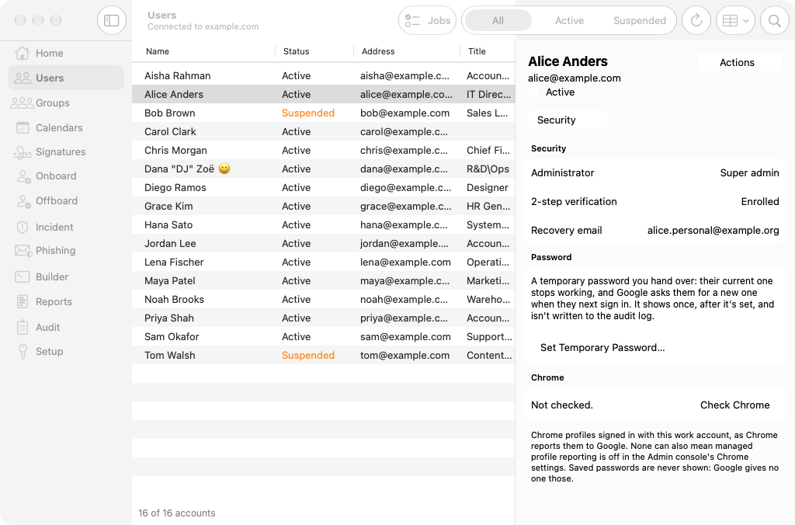

# SwiftGamGui

[](https://github.com/goetchstone/SwiftGamGui/actions/workflows/ci.yml)
[](https://github.com/goetchstone/SwiftGamGui/actions/workflows/codeql.yml)
[](https://scorecard.dev/viewer/?uri=github.com/goetchstone/SwiftGamGui)
[](LICENSE)

A native macOS version of [GamGUI](https://github.com/goetchstone/gamgui), the Google Workspace admin
app built on [GAM7](https://github.com/GAM-team/GAM). It runs the same `gam` commands GamGUI runs, and
the tests check that they match GamGUI's exactly.

**Status: early.** You can import credentials (or copy them from GamGUI), check access, see the
directory's counts and reports, browse users, and change a person: title and department, suspend,
groups, mail delegates, auto-reply, sign-out, and their Gmail signature from a saved template
(Signatures, one person at a time). Every change shows what it will run first and runs only when you
confirm it ([Live verification](#live-verification) lists what has run on a real tenant). Groups lists
the domain's groups and a group's members, and from a group's page adds people with a role or removes a
member. Calendars lists the rooms and a person's calendars, shows who has access, and shares one with a
person or takes access away. Onboard sets up one new hire from a role: the account with a one-time sign-in
card, their signature, groups, calendars and a task checklist, waiting for Google where it must. Offboard
runs GamGUI's offboarding for a leaver from a saved template of the steps you run (yours, Hand-over, by
default): every step's exact command first, then, with the leaver's address typed, each step as it ends, Stop
between steps, and what's left to finish. Reports lists the people behind each of the directory's counts and
reads the storage and mail usage; Audit shows this app's audit log, searched, paged and exported to CSV.
Sharing a calendar with a group, deleting a calendar or an event, a signature for many people at once,
editing onboarding roles and deleting a leaver's account are still GamGUI's. The plan is in
[docs/plans/2026-10-08-native-gamgui.md](docs/plans/2026-10-08-native-gamgui.md).

Not affiliated with Google or the GAM team.

## Screenshots

Rendered by CI from a demo tenant and the test mock of GAM (`scripts/screenshots.sh`), so the names are
placeholders. Each screen's pull request refreshes its own.

| Home | Users | Setup |
|---|---|---|
|  |  |  |

A person's page, opened from Users: an Actions menu for what changes the account, and tabs.

| Profile | Groups | Mail |
|---|---|---|
|  |  |  |

| Calendar | Security |
|---|---|
|  |  |

Groups: the domain's groups, and a group's members, owners first, with Add Members… and a Remove… for
each member.

| Groups | A group's page |
|---|---|
|  |  |

Calendars: the rooms, and a person's calendars with who has access to each; a calendar is shared with a
person, or their access taken away, from its page. Signatures: one person at a time, their current signature
beside the new one, each rendered or as HTML.

| Calendars | A person's calendars | Signatures |
|---|---|---|
|  |  |  |

Onboard: one new hire from a role, and the one-time sign-in card. Offboard: a leaver's offboarding from a
saved template (Hand-over by default), and every step's exact command before it runs.

| Onboard | The sign-in card | Offboard | Its plan |
|---|---|---|---|
|  |  |  |  |

Reports: the people behind each of the directory's counts, and the storage and mail usage. Audit: this app's
audit log, searched, paged and exported to CSV.

| Reports | Usage | Audit |
|---|---|---|
|  |  |  |

## Siri

Say **"Change a title in GAM GUI"** ("Gam Gooey" is heard as GAM GUI, the app's name on screen and to
Siri). Siri asks whose title and the new one (a department too, if you like), and the app opens on Users
with that person selected and the change drafted. Nothing changes
until you check it and click **Save**: Siri only drafts. The same action is in Shortcuts as **Change
a Title**. If more than one person matches the name, the list shows them and nothing is drafted.

**Confirmed through Shortcuts (2026-10-10):** the action drafted a title and department change on a
real tenant, the operator saved it with a click, and the audit recorded `origin: siri`. **Spoken:** Siri
couldn't find "GamGUI" (it hears "GAM GUI", ignores alternative names on the Mac, and the original
GamGUI shares the old name), so the app is now named GAM GUI; the spoken check is open on that build.

## Build from source

You need macOS 27 and Xcode 27.

1. Open Xcode once, or run `sudo xcodebuild -runFirstLaunch`, so its components are installed.
2. Download the pinned GAM: `scripts/fetch_gam.sh`.
3. In Xcode → Settings → Accounts, add your Apple ID (a free Personal Team is enough). Then create
   `Config/Local.xcconfig` (it's gitignored) with your team ID:
   ```
   DEVELOPMENT_TEAM = ABCDE12345
   CODE_SIGN_IDENTITY = Apple Development
   CODE_SIGN_ENTITLEMENTS = Config/GamGUI-Team.entitlements
   ```
   Without this file the app still builds, but it can't save credentials to the Keychain.
4. Open `SwiftGamGui.xcodeproj` and build the **GamGUI** scheme in Xcode once (⌘B). Xcode sets up
   signing with your account on that first build. After that you can also build from the command
   line: `xcodebuild -project SwiftGamGui.xcodeproj -scheme GamGUI build`.

A free Personal Team's signing expires after 7 days, so rebuild in Xcode at least once a week. Your
stored credentials survive a rebuild. If you switch to a different team, import them again.

There are no downloadable builds yet: macOS blocks a downloaded app unless it's signed with a paid
Developer ID and notarized by Apple.

## Tests

`swift test --package-path Packages/GamKit`. CI runs the same tests, then builds the app and checks
how it's signed.

The fixtures the tests compare against are generated from GamGUI. To regenerate them you need a GamGUI
checkout next to this one: `../gamgui/.venv/bin/python -I -B scripts/gen_fixtures.py`. One deliberate
difference: GAM escapes its CSV output with a backslash, which GamGUI's reader doesn't handle, so a name
or description holding a quote can vanish there. This app reads the output as GAM writes it, and the
fixtures list each place where GamGUI reads it differently
([docs/domains/gam-runner.md](docs/domains/gam-runner.md#reading-output)).

## Live verification

Each write will be listed here. **argv-identical** means it sends exactly the command a GamGUI write
already proven live sent; **confirmed** means this app has itself run it against a real tenant.

| Write | Status |
|---|---|
| Title and department (Users) | **confirmed** (2026-10-09) |
| Suspend and unsuspend (Users) | **confirmed** (2026-10-09) |
| Remove from a group (Users) | **confirmed** (2026-10-09) |
| Add to a group (Users) | argv-identical |
| Add a mail delegate (Users) | **confirmed** (2026-10-09) |
| Remove a mail delegate (Users) | **confirmed** (2026-10-10) |
| Turn on or change an auto-reply (Users) | **confirmed** (2026-10-09) |
| Turn off an auto-reply (Users) | **confirmed** (2026-10-10) |
| Sign out of all sessions (Users) | **confirmed** (2026-10-09) |
| Set signature (Signatures) | argv-identical |
| Add people to a group as members (Groups) | argv-identical |
| Add people to a group as managers or owners (Groups) | not yet: never run live in either app |
| Remove a member (Groups) | argv-identical |
| Share a calendar with a person (Calendars) | argv-identical |
| Put a shared calendar in their list (Calendars) | argv-identical |
| Share their own calendar (Users) | argv-identical |
| Remove someone's access to a calendar (Calendars, Users) | GamGUI's command, which GamGUI never ran live either |
| Create an account (Onboard) | argv-identical |
| Task checklist: a task list and its tasks (Onboard) | argv-identical |
| Subscribe to a calendar (Onboard) | argv-identical |
| New-account wait: retrying what Google wasn't ready for (Onboard) | never run live (in GamGUI either) |
| Offboarding: reset password, sign out, forwarding off, delegate, auto-reply, transfer, calendar sweep (Offboard) | argv-identical (GamGUI ran all eight live, 2026-10-07) |
| Offboarding: the manager's reminder with an invitee (Offboard) | argv-identical; the invitee's email unproven live in either app |

The Groups rows are checked on a scratch group the operator owns, with throwaway members or the
operator's own account, never someone's real group without their yes.

## License

MIT. GAM is Apache-2.0 (`Vendor/gam7/LICENSE`).
